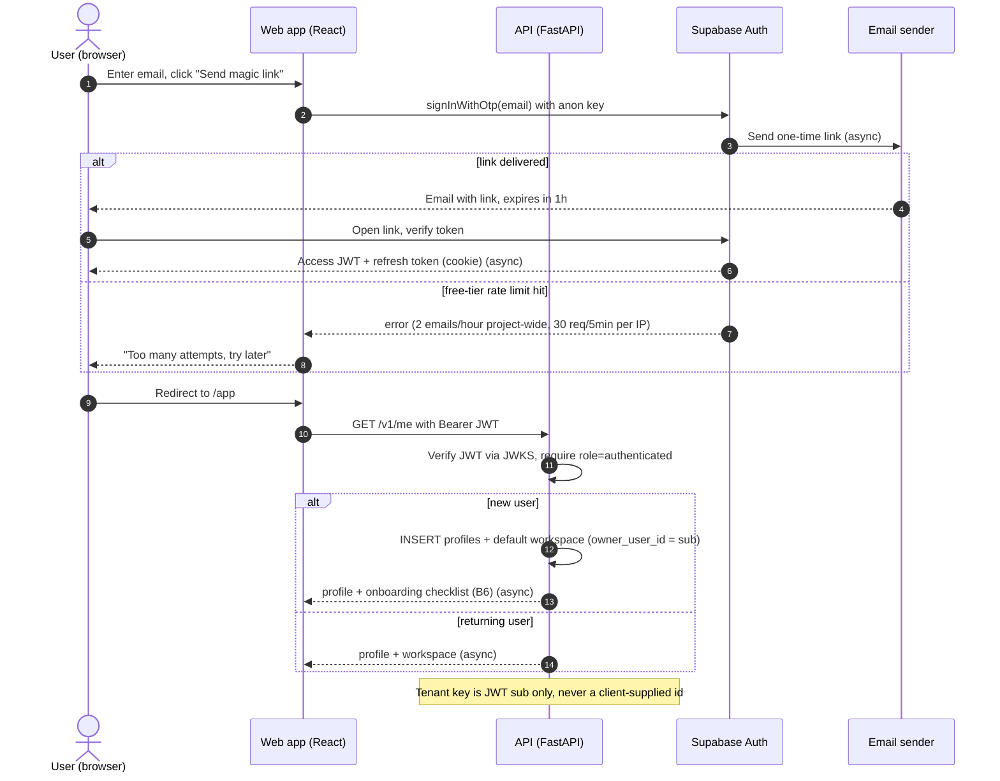
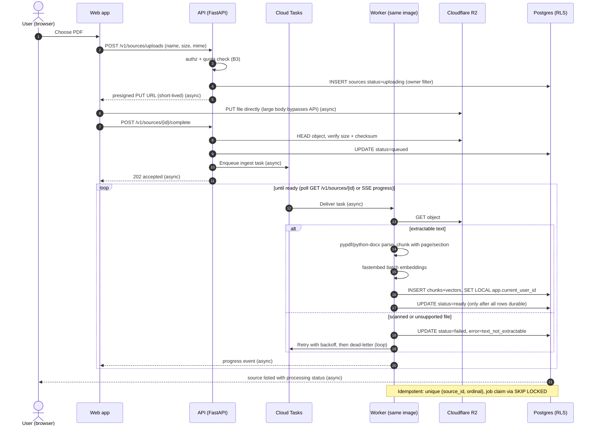
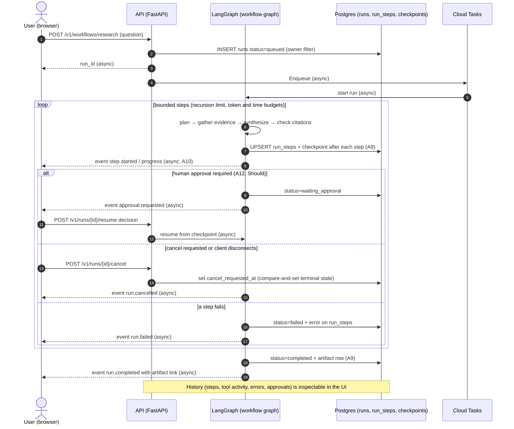
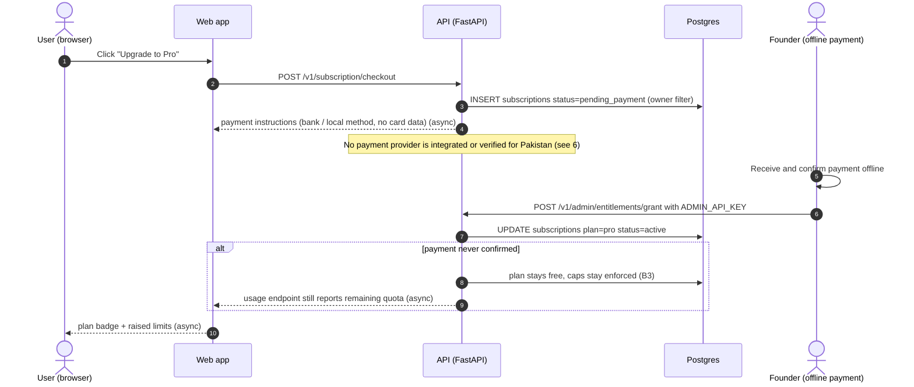

# Oristoria — Technical Design (private beta)

**Role:** Senior engineer writing the implementation plan for `docs/PRD.md`.
**Scope:** Must features A1–A7, A9–A11, B1, B3, B5, B6, C1, C3. Should features (A8, A12, A13, B2, B4, C2) are designed for but not built in the beta.
**Verification date:** 2026-11-23. Every free-tier number below was checked against official docs on that date and is cited. Anything marked **LIVE CHECK** was *not* verified and must be verified manually before it is relied upon.
**Budget:** $0/month for the whole private beta.

---

## Assumptions (made without asking, per instructions)

1. **Backend language:** the PRD names no stack. Python is chosen because LangGraph, pypdf, and fastembed are Python-first; frontend is React.
2. **Tenant model:** 1 account = 1 active workspace (PRD "personal workspace"). No teams, roles, or sharing in the beta.
3. **LLM providers:** the PRD lists OpenRouter, Groq, and NVIDIA NIM. All three sit behind one interface: OpenRouter primary, Groq and NIM fallback. Every free tier is rate-limited (§5), so fallback is a requirement, not a nicety.
4. **Billing:** PRD B2 = manual payment at launch. No payment provider is integrated, and **no payment provider has been verified as available to a Pakistan-based seller** — stated plainly in §6.
5. **Auth email:** Supabase Auth built-in email is used first (free, but only **2 emails/hour project-wide**). Moving auth email to a custom SMTP/Resend is a **LIVE CHECK** (free-plan custom-SMTP support not verified).
6. **Scanned PDFs (known A1 gap):** pypdf extracts text from digital PDFs only. Scanned/image-only PDFs fail with `text_not_extractable`. OCR is out of scope for the beta.
7. **LangSmith (PRD OQ-06):** disabled by default — no account, no cost, no dependency.
8. **Upstash Redis:** evaluated and **deferred**. Metering (B3) and the job queue use Postgres + Cloud Tasks, removing one vendor from the $0 surface.
9. **Region:** Supabase project runs in `ap-northeast-1` (existing project, §9). Cloud Run region should be chosen near it — **LIVE CHECK** on which regions are eligible for the free-tier region list used here.
10. **Cancelled/failed runs are not billable**; usage policy is recorded in `usage_events` so it can change without a schema change.

---

## 1. Stack (one-line justification + rejected alternative)

| # | Layer | Choice (why, one line) | Rejected alternative (why not) |
|---|-------|------------------------|--------------------------------|
| 1 | Frontend framework | **React 19 + TypeScript** — a chat/knowledge SPA needs no server rendering, and static output hosts at $0 (https://react.dev/learn/installation) | Next.js — SSR/server components would require a second hosted runtime we do not need |
| 2 | Build tool | **Vite** — official React template, instant HMR, single static build for Pages (https://vite.dev/guide/) | Hand-configured webpack — more configuration, no benefit for this app |
| 3 | Routing | **React Router v7, declarative/library mode** — verified install path, works from a static bundle (https://reactrouter.com/start/library/installation) | React Router framework mode / SSR frameworks — need a server runtime Cloudflare Pages does not provide |
| 4 | Browser HTTP | **native `fetch` + typed wrappers** — zero dependency, streaming/SSE works out of the box | axios — extra dependency for no capability gain |
| 5 | API framework | **FastAPI + Uvicorn** — async-native, Pydantic validation, `StreamingResponse` for SSE answers (https://fastapi.tiangolo.com/, https://fastapi.tiangolo.com/advanced/custom-response/#streamingresponse) | Flask — no native async streaming story, weaker typing/OpenAPI |
| 6 | Validation + config | **Pydantic v2 + pydantic-settings** — one typed model layer for API contracts and env config, incl. `.env` loading (https://pypi.org/project/pydantic/, https://pypi.org/project/pydantic-settings/) | `os.environ` + hand checks — silent misconfiguration until runtime |
| 7 | ORM + migrations | **SQLAlchemy 2 async + Alembic** — standard async ORM with an official async migration recipe (https://pypi.org/project/sqlalchemy/, https://pypi.org/project/alembic/) | supabase-py/PostgREST as the only data path — no cross-table transactions for our own domain logic |
| 8 | DB driver | **asyncpg** for the app (SQLAlchemy's documented async dialect) + **psycopg 3** for the LangGraph checkpointer, which officially requires `psycopg>=3.2` (https://pypi.org/project/asyncpg/, https://pypi.org/project/psycopg/) | One driver for everything — the official LangGraph Postgres checkpointer does not support asyncpg |
| 9 | Agent orchestration | **LangGraph + `langgraph-checkpoint-postgres`** — versioned bounded graphs, streamed events, durable checkpoints for conversation/resume (https://pypi.org/project/langgraph/, https://pypi.org/project/langgraph-checkpoint-postgres/) | Hand-rolled state machine — reinvents streaming, persistence, and step history |
| 10 | LLM access | **OpenRouter (primary) + Groq + NVIDIA NIM fallback** behind one interface — three independent free quotas multiply effective capacity (https://openrouter.ai/docs/api_reference/limits, https://console.groq.com/docs/rate-limits, https://build.nvidia.com/settings/limits) | Single-provider SDK hardwired — a 429 on one free tier takes the product down |
| 11 | Outbound HTTP | **httpx (async)** — shared by API, worker, and `scripts/doctor.py` (https://pypi.org/project/httpx/) | `requests` — sync-only, blocks the event loop |
| 12 | Embeddings | **fastembed (ONNX, CPU) → pgvector** — embeddings at $0 with no per-token API (https://pypi.org/project/fastembed/, https://supabase.com/docs/guides/database/extensions/pgvector) | Hosted embedding API — recurring cost that breaks the $0 budget |
| 13 | Vector/keyword search | **pgvector + Postgres full-text, hybrid merge in SQL** — same database, same RLS, no extra vendor | Dedicated vector DB (Pinecone etc.) — unverified free tier, another tenant boundary to secure |
| 14 | Document extraction | **pypdf (PDF) + python-docx (.docx)** — pure Python, no GPU (https://pypdf.readthedocs.io/en/latest/user/extract-text.html, https://pypi.org/project/python-docx/) | Paid extraction/OCR API — cost + another vendor; OCR deferred (assumption 6) |
| 15 | Object storage | **Cloudflare R2 via boto3 (S3 API)** — 10 GB-month free, 1M/10M Class A/B ops, **zero egress fees** (https://developers.cloudflare.com/r2/pricing, https://developers.cloudflare.com/r2/examples/aws/boto3/) | Supabase Storage — only 1 GB free and egress is metered (https://supabase.com/pricing) |
| 16 | Background jobs | **Google Cloud Tasks → HTTP handler on the same Cloud Run service** — first 1M billable ops/mo free, scales to zero (https://cloud.google.com/tasks/pricing) | Celery + Redis — an always-on worker plus another vendor to fund and operate |
| 17 | Metering / plan caps (B3) | **Postgres `usage_events` + period counters with row locks** — transactional, RLS-scoped, survives restarts | Upstash Redis — free tier verified (250 MB, https://upstash.com/pricing/redis) but unnecessary at beta scale (deferred, assumption 8) |
| 18 | Authentication (B1) | **Supabase Auth, email magic link** — 50k MAU free, managed OTP/expiry/refresh (https://supabase.com/docs/guides/auth/auth-email-passwordless) | Self-hosted auth — sessions, link expiry, deliverability = weeks of work and new attack surface |
| 19 | Transactional email | **Resend HTTP API via httpx** — 100 emails/day, 3,000/month free (https://resend.com/docs/knowledge-base/account-quotas-and-limits) | Supabase built-in SMTP as the only sender — only **2 emails/hour project-wide**, too weak for beta signups |
| 20 | Frontend hosting | **Cloudflare Pages** — unlimited static requests, 500 builds/mo, 1 concurrent, 20k files (https://developers.cloudflare.com/pages/platform/limits) | Vercel Hobby — free plan is restricted to **non-commercial/fair use**, wrong for a commercial SaaS (https://vercel.com/docs/plans/hobby) |
| 21 | Backend hosting | **Google Cloud Run, min instances = 0** — 180,000 vCPU-s + 360,000 GiB-s + 2M requests free per month (request-based; https://cloud.google.com/run/pricing) | Railway/Fly.io — no verified free tier for commercial use as of the verification date |
| 22 | Logs | **structlog JSON → Cloud Logging** — structured request/worker/run logs with provider-native retention (https://pypi.org/project/structlog/) | Commercial APM (Datadog etc.) — paid; Cloud Logging free allowance is **LIVE CHECK** |
| 23 | LLM tracing | **LangSmith off** — PRD OQ-06 is undecided, so no account and no cost | LangSmith on by default — unverified cost, blocks OQ-06 |

---

## 2. Tenancy and authentication

**Model:** one Supabase Auth user = one individual account = **one active workspace** (PRD). The tenant key is the JWT `sub` (user UUID). No membership/role/invitation tables exist in the beta.

### 2.1 Two data paths, one isolation rule

1. **Browser → FastAPI (primary):** the browser holds only the Supabase **anon** key and the user's access JWT. Every product endpoint requires `Authorization: Bearer <jwt>`. The browser never receives the service-role key and never queries tenant tables through PostgREST directly.
2. **FastAPI → Supabase Postgres (direct):** the API connects as a dedicated, non-superuser role `app_api` that does **not** own the tables and has no `BYPASSRLS`.

### 2.2 Defense in depth (three layers, all mandatory)

| Layer | Mechanism |
|-------|-----------|
| **L1 — DB-enforced (RLS)** | Every tenant table: `ENABLE ROW LEVEL SECURITY` + `FORCE ROW LEVEL SECURITY`. Policy for role `authenticated` (any direct Data API access): `USING ((select auth.uid()) = owner_user_id)` with `TO authenticated`, plus matching `WITH CHECK` on INSERT/UPDATE. Policy for role `app_api`: `USING (current_setting('app.current_user_id', true)::uuid = owner_user_id)` — the API sets it **`SET LOCAL`** inside the request transaction, so it is released at commit/rollback and cannot leak across pooled connections. |
| **L2 — query-filtered** | Every repository method takes `owner_user_id` from the *verified* JWT `sub` (never from the request body) and adds `WHERE owner_user_id = :uid` explicitly. RLS is the backstop, not the only guard. |
| **L3 — endpoint-guarded** | A single FastAPI dependency (`get_current_user`) verifies signature against Supabase JWKS (`iss`, `aud`, `exp`, `role == "authenticated"`, unknown-`kid` refresh once), then every router requires it. `service_role` and `anon` tokens are rejected. |

Supporting rules (from the Supabase RLS guidance, https://supabase.com/docs/guides/database/postgres/row-level-security):

- **Indexes:** every tenant table has `(owner_user_id, created_at DESC)`; child tables also index their FK (`documents(workspace_id)`, `chunks(document_id)`, `messages(conversation_id)`, `answer_citations(message_id)`, `run_steps(run_id)`). RLS predicates run on indexed columns so policies do not degrade into sequential scans (https://supabase.com/docs/guides/database/postgres/row-level-security#rls-performance).
- **Composite FK:** child tables carry both `owner_user_id` and `workspace_id`, and FK to `workspaces(id, owner_user_id)` — a row can never pair account A's owner with account B's workspace.
- **Grants:** `anon` and `PUBLIC` get nothing on tenant tables; `app_api` gets only the DML it needs; the migration/owner role is never used by the app.
- **No public `SECURITY DEFINER` functions; views are `security_invoker`.**
- **Service role** (BYPASSRLS) is used *only* in narrowly scoped admin paths (Auth user deletion for B5) and never for ordinary product queries.

### 2.3 Request lifecycle (per API request)

1. `get_current_user` validates JWT → `uid`.
2. Open transaction on the `app_api` connection: `SET LOCAL app.current_user_id = '<uid>'`.
3. Run queries (RLS + explicit owner filter) → commit.
4. Never hold a transaction open while calling an LLM, parser, or storage — each graph node/repository call uses a short transaction (avoids pool exhaustion).

### 2.4 Auth flow specifics (B1)

- Magic link via Supabase Auth (email OTP). Verified limits: sign-up/sign-in **30 requests / 5 min per IP**, OTP resend **60 s per-user window**, links **expire after 1 hour**, built-in email provider **2 emails/hour project-wide** (https://supabase.com/docs/guides/auth/rate-limits).
- Redirect URLs are allow-listed per environment (https://supabase.com/docs/guides/auth/redirect-urls).
- **Logout:** a JWT stays cryptographically valid until expiry, so `POST /v1/auth/logout` records the session id in `revoked_sessions` and subsequent requests carrying it are rejected; the browser also revokes the Supabase refresh session and clears its cookie.
- Account deletion (B5) calls the Supabase Admin API with the service-role key to remove the Auth user after app data is deleted.

---

## 3. Sequence diagrams

Legend: `->>` = synchronous call, `-->>` = **async / streamed** reply (highlighted where it matters), `alt` = branches, `loop` = repeated steps.

### D1 — Sign-up / login (magic link) — feature B1 (+ B6 onboarding start)



### D2 — Upload and async ingestion — features A1, A3, A9 (+ A4 prep)



### D3 — Ask a question → grounded, streamed answer — features A2, A4, A5, A6, A10, A11, B3, C1 (core flow)

```mermaid
sequenceDiagram
    autonumber
    actor U as User (browser)
    participant W as Web app
    participant A as API (FastAPI)
    participant G as LangGraph (answer graph)
    participant DB as Postgres (RLS + pgvector)
    participant L as LLM provider (OpenRouter, Groq, NIM fallback)

    U->>W: Ask question in conversation
    W->>A: POST /v1/conversations/{id}/answers (fetch + SSE reader)
    A->>A: Verify JWT, owner scoping, plan-cap check (B3)
    alt over free-plan cap
        A-->>W: event run.blocked + 429 semantics (async)
    end
    A->>G: invoke with thread checkpoint (async)
    G->>DB: hydrate conversation + approved memory (A6)
    G->>DB: hybrid retrieval: pgvector top-k + full-text, filter status=ready (A4)
    G->>DB: build cross-source evidence table: support / contradict / uncertain (A5)
    alt no sufficient evidence
        G-->>W: event answer.delta "workspace does not establish this" (async)
    else prompt injection or prohibited content detected (A11)
        G->>DB: INSERT safety_events intervention
        G-->>W: event safety.intervention then refusal (async)
    else proceed
        loop stream tokens until finish
            G->>L: chat completion stream (async)
            L-->>G: token deltas (async)
            G-->>W: event answer.delta (async, A10)
        end
        G->>G: validate model citations against server-assigned chunk labels
        alt unknown or unsupported citation
            G->>DB: mark citation unsupported, strip claim (C1)
        end
        G->>DB: INSERT messages + answer_citations + excerpt snapshot (A2)
        G->>DB: INSERT usage_events, settle quota (B3)
        G-->>W: events citation, run.completed (async)
    end
    W-->>U: render tokens live, clickable citation opens passage (C1)
    Note over W,A: Every event carries run_id + sequence number; client ignores duplicates
```

### D4 — Multi-step workflow run with resume/cancel — features A7, A9 (+ A13, A12 as Should)



### D5 — Manual payment → plan activation — features B2 (Should) + B3 (Must)



---

## 4. Data model and API contract

### 4.1 Conventions

- Every tenant table: `owner_user_id uuid NOT NULL REFERENCES auth.users(id)`, `workspace_id uuid NOT NULL`, `created_at timestamptz NOT NULL DEFAULT now()`, plus `FORCE ROW LEVEL SECURITY`.
- Every table below has RLS per §2.2; `plan_limits` and `plans` are read-only reference data.
- Vector column: `embedding vector(384)` (fastembed default dimension; fixed by the first migration, model id stored on each chunk for future re-indexing).

### 4.2 Tables

| Table | Key columns (beyond ids/timestamps) | Purpose / Must feature | Indexes beyond PK |
|-------|-------------------------------------|------------------------|-------------------|
| `profiles` | `email`, `onboarding_state jsonb` | Account row; B6 onboarding progress | PK `user_id` (= auth.users id) |
| `workspaces` | `owner_user_id`, `name`, `is_active` | One active workspace per account (A3) | `UNIQUE (owner_user_id) WHERE is_active` |
| `sources` | `owner_user_id`, `workspace_id`, `title`, `r2_key`, `mime`, `size_bytes`, `status` (`uploading/queued/processing/ready/failed`), `error_code`, `page_count` | Uploaded documents, processing status (A1) | `(owner_user_id, created_at DESC)`, `(workspace_id)` |
| `chunks` | `owner_user_id`, `workspace_id`, `source_id`, `ordinal`, `page_from`, `page_to`, `section`, `text`, `content_hash`, `embedding_model`, `embedding vector(384)` | Searchable passages (A2/A4) | `(source_id, ordinal)` UNIQUE, `(owner_user_id, source_id)`, pgvector index (exact scan at beta size; HNSW only after benchmark) |
| `conversations` | `owner_user_id`, `workspace_id`, `title`, `thread_id` (LangGraph) | Chat threads (A6) | `(owner_user_id, created_at DESC)` |
| `messages` | `owner_user_id`, `conversation_id`, `role`, `content`, `state` (`streaming/completed/cancelled/failed`) | Turn history (A6, A9) | `(conversation_id, created_at)` |
| `answer_citations` | `owner_user_id`, `message_id`, `chunk_id`, `label`, `excerpt_snapshot`, `page_from`, `verdict` (`linked/verified/unsupported/needs_review`), `verdict_by` | Grounded claims + audit (A2, C1) | `(message_id)`, `(chunk_id)` |
| `runs` | `owner_user_id`, `workspace_id`, `kind`, `status` (`queued/running/waiting_approval/completed/failed/cancelled`), `workflow_version`, `cancel_requested_at`, `error_code` | Bounded multi-step work + history (A7, A9, A13) | `(owner_user_id, created_at DESC)` |
| `run_steps` | `owner_user_id`, `run_id`, `seq`, `node`, `state`, `attempt`, `model`, `tokens_in/out`, `activity jsonb`, `error` | Inspectable step/tool activity (A9, A10) | `(run_id, seq)` |
| `artifacts` | `owner_user_id`, `workspace_id`, `run_id`, `kind`, `title`, `body text` or `r2_key`, `status` | Persistent outputs (A9, C3) | `(owner_user_id, created_at DESC)` |
| `memories` | `owner_user_id`, `workspace_id`, `kind`, `content`, `status` (`pending/approved/rejected/deleted`), `scope`, `source_message_id` | Approved cross-session facts (A6; C2 later) | `(owner_user_id, status)` |
| `safety_events` | `owner_user_id`, `run_id`, `category` (`injection/prohibited/pii_redacted`), `action`, `detail jsonb` | Recorded interventions (A11) | `(owner_user_id, created_at DESC)` |
| `usage_events` | `owner_user_id`, `metric`, `units`, `billable bool`, `ref_id`, `idempotency_key UNIQUE`, `provider`, `model`, `tokens_in/out` | Append-only metering (B3) | `(owner_user_id, metric, created_at DESC)` |
| `usage_counters` | `owner_user_id`, `metric`, `period_start`, `consumed`, `reserved` | Atomic cap enforcement (B3) | `UNIQUE (owner_user_id, metric, period_start)` — row-locked during reservation |
| `subscriptions` | `owner_user_id` PK, `plan` (`free/pro`), `status` (`active/pending_payment`), `payment_ref`, `updated_by` | Manual billing state (B2/B3) | — |
| `plans` / `plan_limits` | `plan`, `metric`, `cap`, `period` | Reference caps (B3) | `UNIQUE (plan, metric)` |
| `revoked_sessions` | `owner_user_id`, `session_id`, `revoked_at` | Logout enforcement (B1) | `(session_id)` |
| `export_jobs` / `deletion_requests` | `owner_user_id`, `state`, `r2_key`, `error` | Export/delete (B5) | `(owner_user_id, created_at DESC)` |
| `ingest_jobs` | `owner_user_id`, `source_id`, `state`, `attempts`, `lease_expires_at`, `next_attempt_at`, `error_code` | Durable ingestion queue state (A1, A13) | partial index on `state` for `SKIP LOCKED` claiming |

Deliberate denormalization: `owner_user_id` **and** `workspace_id` on every child row → simple, indexed RLS predicates, and a composite FK to `workspaces(id, owner_user_id)` makes cross-account pairing impossible.

### 4.3 API contract

All endpoints are under `/v1`, require `Authorization: Bearer <supabase access JWT>`, and **filter by `owner_user_id = JWT.sub` (plus `workspace_id` where applicable) in SQL and via RLS**. Errors: `{code, message, request_id}`. Mutations accept `Idempotency-Key`. Streaming endpoints use **POST + SSE** (fetch-based reader, so the bearer token can be attached; `EventSource` cannot).

| Method + path | Purpose | Owner scoping | Notes |
|---------------|---------|---------------|-------|
| `POST /v1/auth/magic-link` | Send sign-in link | n/a (pre-auth) | Rate-limited by Supabase (30/5min/IP) |
| `POST /v1/auth/logout` | Revoke current session | `session_id` of caller | Idempotent (B1) |
| `GET /v1/me` | Profile + workspace + onboarding | `sub` | B6 entry point |
| `GET/PATCH /v1/workspace` | Read/rename workspace | `owner_user_id` | A3 |
| `POST /v1/sources/uploads` | Create source + presigned PUT | insert under caller | A1 |
| `POST /v1/sources/{id}/complete` | Verify object, enqueue ingest | `owner_user_id = sub` | A1 |
| `GET /v1/sources` · `GET /v1/sources/{id}` | List/status | `owner_user_id = sub` | A1 |
| `DELETE /v1/sources/{id}` | Remove file, chunks, vectors | `owner_user_id = sub` | B5 partial |
| `GET /v1/sources/{id}/access` | Short-lived signed GET URL | `owner_user_id = sub` checked first | A1/C1, R2 presigned |
| `POST /v1/search` | Hybrid semantic+keyword search | `owner_user_id = sub` + `status=ready` | A4 |
| `POST /v1/conversations` · `GET /v1/conversations` | Threads | `owner_user_id = sub` | A6 |
| `POST /v1/conversations/{id}/answers` | **Streamed** grounded answer (SSE) | conversation's `owner_user_id = sub` | A2/A5/A10/A11/B3 → diagram D3 |
| `GET /v1/conversations/{id}/messages` | History incl. citations | `owner_user_id = sub` | A9 |
| `GET /v1/citations/{id}` | Open source passage (C1) | `owner_user_id = sub` | excerpt snapshot + page |
| `POST /v1/citations/{id}/audit` | Record supported/unsupported | `owner_user_id = sub` | C1 |
| `POST /v1/workflows/{kind}` | **Streamed** run (SSE) | insert under caller | A7/C3 → diagram D4 |
| `POST /v1/runs/{id}/cancel` · `POST /v1/runs/{id}/resume` | Cancel / approve-resume | `owner_user_id = sub` | A10, A12 |
| `GET /v1/runs` · `GET /v1/runs/{id}` | Run history + steps | `owner_user_id = sub` | A9 |
| `GET /v1/artifacts` · `GET/DELETE /v1/artifacts/{id}` | Outputs | `owner_user_id = sub` | A9/C3 |
| `GET /v1/memories` · `POST /v1/memories/{id}/decision` · `DELETE /v1/memories/{id}` | Memory view/approve/forget | `owner_user_id = sub` | A6 (C2 later) |
| `GET /v1/usage` | Remaining quota (B3) | `owner_user_id = sub` | |
| `GET /v1/privacy/export` · `DELETE /v1/account` | Export / delete (B5) | `owner_user_id = sub` | async jobs |
| `POST /v1/subscription/checkout` | Start manual payment (B2) | insert under caller | → diagram D5 |
| `POST /v1/admin/entitlements/grant` | Founder activates plan | admin only (`ADMIN_API_KEY`) | no user access |
| `GET /healthz`, `GET /v1/readyz` | Probes | none | used by `scripts/doctor.py` |

---

## 5. External services (why · free-tier limits · wrapper · test fake · live check)

All limits verified 2026-11-23 against the cited official page; each is sufficient for a $0 private beta at expected volume, with the noted risks.

| Service | Why it's needed | Free tier (verified, with source) | Wrapper module | Test fake (no network) | **LIVE CHECK** (first manual verification) |
|---------|-----------------|-----------------------------------|----------------|------------------------|-----------------------------------------------|
| **Supabase** (Auth + Postgres + pgvector) | Auth authority, tenant DB, vectors | 500 MB DB, 50k MAU, 5 GB egress, 1 GB storage, unlimited API requests; **free projects pause after 1 week of inactivity**; **max 2 active projects** (https://supabase.com/pricing). Auth: 2 emails/hour project-wide, 30 sign-in req/5 min/IP, links expire 1 h (https://supabase.com/docs/guides/auth/rate-limits) | `app/db/session.py`, `app/services/auth/supabase_auth.py` | In-process SQLite/Postgres fixture; `FakeUser` issuing fixed UUIDs | Unpause the paused project (§9), send 10 magic links back-to-back and record actual throttle behavior |
| **Cloudflare R2** | Private originals + artifacts, zero egress | 10 GB-month storage, 1M Class A, 10M Class B ops, **$0 egress** (https://developers.cloudflare.com/r2/pricing) | `app/services/storage/r2.py` (boto3, `region_name="auto"`) | `FakeStorage`: in-memory dict of bytes | Create bucket + API token, presign PUT/GET, upload and re-download a real PDF |
| **Cloudflare Pages** | Static React hosting | 500 builds/mo, 1 concurrent build, 20k files, 25 MiB/asset, unlimited static requests, 100 custom domains (https://developers.cloudflare.com/pages/platform/limits) | `infra/pages/` (build config only) | n/a (local `vite preview`) | Push a branch → confirm preview deploy + custom-domain routing |
| **Google Cloud Run** | API + worker container, scale-to-zero | Request-based: 180,000 vCPU-s, 360,000 GiB-s, 2M requests/month free; instance-based: 240,000 vCPU-s / 450,000 GiB-s (us-central1) (https://cloud.google.com/run/pricing) | `infra/cloudrun/` (service definition) | Local `uvicorn` process | Deploy, then verify an SSE answer streams without proxy buffering; confirm cold-start latency |
| **Google Cloud Tasks** | Durable ingestion/workflow queue | First 1M billable operations/month free; tasks retained up to 31 days; schedules max 30 days out (https://cloud.google.com/tasks/pricing, https://docs.cloud.google.com/tasks/docs/quotas) | `app/services/queue/tasks.py` (`google-cloud-tasks`) | `InlineQueue`: runs the handler synchronously in tests | Enqueue a real task → confirm the Cloud Run handler receives it, then delete the queue task |
| **OpenRouter** (primary LLM) | One API, many models, free-model quotas | Per-model free-request caps, per-IP burst limits, org budget limits (https://openrouter.ai/docs/api_reference/limits) | `app/services/llm/openrouter.py` | `FakeLLM`: scripted token deltas | One real chat-completion call; record RPM before a 429 appears |
| **Groq** (fallback LLM) | Very high throughput free tier | Org-level RPM/TPM/TPD limits published per model (https://console.groq.com/docs/rate-limits) | `app/services/llm/groq.py` | same `FakeLLM` interface | One real call + deliberately exceed RPM to confirm 429/Retry-After handling |
| **NVIDIA NIM** (fallback LLM) | Free prototype tier, no per-token billing | Prototype tier ≈ 40 requests/minute (https://build.nvidia.com/settings/limits) | `app/services/llm/nim.py` | same `FakeLLM` interface | One real call from `build.nvidia.com` API key; confirm key works from Cloud Run's egress IP |
| **Resend** | Non-auth email (notifications, export-ready mail) | 100 emails/day, 3,000/month, 3 verified domains (https://resend.com/docs/knowledge-base/account-quotas-and-limits) | `app/services/email/resend.py` (httpx → REST API) | `RecordingEmail`: captures payloads for assertions | Verify a domain, send one real email, confirm inbox delivery + SPF/DKIM pass |
| **Google Cloud Logging** | Structured logs from API/worker | Free allowance **LIVE CHECK** (not verified) | `app/log.py` (structlog JSON) | `MemoryHandler` in tests | Send 100 log lines, read them in the console, check the billing page for $0 |
| **LangSmith** | LLM tracing (PRD OQ-06, undecided) | **Not verified — intentionally unused**; tracing disabled unless `LANGSMITH_API_KEY` is set | `app/services/tracing.py` (no-op default) | no-op | None until OQ-06 is decided |
| ~~Upstash Redis~~ | Deferred (assumption 8): metering + queue live in Postgres/Cloud Tasks | 250 MB / 10 GB bandwidth (https://upstash.com/pricing/redis) — recorded for a later re-evaluation | — | — | Revisit only if Postgres metering shows contention |

Rules: no service is called from code except through its wrapper module; production credentials never appear in the frontend bundle; every wrapper has a fake with the same interface so the test suite runs with zero network.

---

## 6. Billing

**Does the PRD need billing?** Yes — B3 (usage metering and plan limits) is Must; B2 (subscription with manual payment) is Should and is included here as designed-only.

**Provider status, stated plainly:** the PRD specifies a flat individual subscription with **manually collected payment at launch**, and the seller is **based in Pakistan**. **No payment provider (Stripe, Paddle, Chargebee, PayPal, or any local processor) has been verified as available, affordable, or compliant for a Pakistan-based seller** — I did not verify one, and the design therefore does not depend on any. Payment happens **off-platform** (bank transfer / local method arranged with the founder); the product only records the outcome.

Design (provider-agnostic):

- **State lives in `subscriptions`** (`plan`, `status`, `payment_ref`) and **caps live in `plan_limits`** — nothing about enforcement knows how payment happened.
- **Enforcement (B3, works on day one):** before every metered call, the API opens a transaction, locks the caller's `usage_counters` row, checks `consumed + reserved + requested ≤ cap`, reserves, commits, calls the provider, then settles with an idempotent `usage_events` row. Concurrent requests therefore cannot oversubscribe a cap; a failed provider call releases the reservation.
- **A single seam for the future:** `app/services/billing/provider.py` defines `request_checkout()`, `verify_confirmation()`, `grant_entitlement()`. The beta ships **`ManualProvider`** (creates the pending row + instructions, grants via the founder-only admin endpoint → diagram D5). Any future automated provider is a second implementation of the same interface — **but switching to one requires first verifying Pakistan availability, fees, and payout support; that verification is an open founder task, not an engineering assumption.**
- No card data, no payment webhooks, and no public "mark as paid" endpoint exist in the beta.

---

## 7. Folder structure and packages

### 7.1 Repository layout

```text
oristoria/
├─ docs/                        # PRD.md, TECH_DESIGN.md
├─ apps/
│  ├─ web/                      # React + Vite SPA (Cloudflare Pages)
│  │  ├─ src/
│  │  │  ├─ routes/             # auth, workspace, sources, chat, runs, settings
│  │  │  ├─ components/         # stream viewer, citation drawer, run timeline
│  │  │  ├─ api/                # typed fetch wrappers + SSE reader
│  │  │  └─ auth/               # supabase-js client, session hooks
│  │  ├─ tests/                 # vitest + testing-library
│  │  └─ vite.config.ts
│  └─ api/                      # FastAPI + worker (one image, two processes)
│     ├─ app/
│     │  ├─ main.py             # app factory, CORS, routers
│     │  ├─ config.py           # pydantic-settings (.env)
│     │  ├─ deps/auth.py        # JWT verification, owner extraction
│     │  ├─ routers/            # auth, sources, search, conversations, workflows, runs, citations, artifacts, memories, usage, privacy, subscription, admin
│     │  ├─ db/                 # engine, session, models (SQLAlchemy), repositories (all owner-filtered)
│     │  ├─ services/
│     │  │  ├─ llm/             # base.py + openrouter.py + groq.py + nim.py
│     │  │  ├─ embeddings/      # fastembed wrapper
│     │  │  ├─ extraction/      # pypdf + python-docx adapters, allowlist
│     │  │  ├─ storage/         # r2.py presign/put/get/delete
│     │  │  ├─ queue/           # tasks.py (Cloud Tasks) + inline fake
│     │  │  ├─ email/           # resend.py
│     │  │  ├─ guardrails/      # injection/prohibited-content checks (A11)
│     │  │  ├─ metering/        # reservation + settlement (B3)
│     │  │  └─ billing/         # provider.py + manual.py (B2)
│     │  ├─ graph/              # state.py, nodes/, answer_graph.py, workflows/, checkpointer.py
│     │  └─ schemas/            # pydantic request/response models
│     ├─ migrations/            # Alembic (owns schema; runs as owner role)
│     ├─ tests/                 # unit + RLS integration + contract
│     └─ Dockerfile
├─ packages/shared/             # generated OpenAPI client + shared TS types
├─ scripts/
│  ├─ doctor.py                 # env + connectivity checks (httpx)
│  ├─ keepalive.py              # weekly Supabase anti-pause ping
│  └─ seed_dev.py               # demo workspace + sample PDF
├─ infra/                       # cloudrun/, tasks/, pages/ definitions
├─ .env.example                 # names only, no secrets
└─ docker-compose.yml           # local Postgres (pgvector) for tests
```

### 7.2 Python packages (apps/api) — official registry links

| Package | Purpose | Registry / official docs |
|---------|---------|--------------------------|
| `fastapi` (0.165.x) | HTTP API, SSE streaming | https://pypi.org/project/fastapi/ |
| `uvicorn` (0.54.x) | ASGI server on Cloud Run | https://pypi.org/project/uvicorn/ |
| `pydantic` (2.14.x) | Validation, API + graph schemas | https://pypi.org/project/pydantic/ |
| **`pydantic-settings` (2.16.x)** | **`.env` loader + typed settings** (docs: https://pydantic.dev/docs/validation/latest/concepts/pydantic_settings/) | https://pypi.org/project/pydantic-settings/ |
| `python-dotenv` (1.2.x) | Local `.env` reading (used by scripts) | https://pypi.org/project/python-dotenv/ |
| `sqlalchemy` (2.1.x) | Async ORM | https://pypi.org/project/sqlalchemy/ |
| **`asyncpg` (0.32.x)** | **DB driver** for SQLAlchemy (`postgresql+asyncpg://`) | https://pypi.org/project/asyncpg/ |
| `psycopg[binary]` (3.2.x) | Driver for the LangGraph checkpointer (required `>=3.2`) | https://pypi.org/project/psycopg/ |
| `alembic` (1.20.x) | Migrations | https://pypi.org/project/alembic/ |
| `langgraph` (1.2.x) | Bounded workflows, streaming | https://pypi.org/project/langgraph/ |
| `langgraph-checkpoint-postgres` (3.2.x) | Durable conversation/run checkpoints (`PostgresSaver`) | https://pypi.org/project/langgraph-checkpoint-postgres/ |
| **`httpx` (0.28.x)** | **Async HTTP client — LLM calls, Resend, and `scripts/doctor.py`** | https://pypi.org/project/httpx/ |
| `pypdf` (7.x) | PDF text extraction (A1) | https://pypi.org/project/pypdf/ |
| `python-docx` (1.2.x) | .docx extraction (A1) | https://pypi.org/project/python-docx/ |
| `fastembed` | Local ONNX embeddings (A4) | https://pypi.org/project/fastembed/ |
| `boto3` (1.44.x) | Cloudflare R2 (S3-compatible) | https://pypi.org/project/boto3/ |
| `supabase` (2.34.x) | Auth admin: magic-link ops, user deletion (B5) | https://pypi.org/project/supabase/ |
| `pyjwt` (2.15.x) | JWT verification against Supabase JWKS | https://pypi.org/project/pyjwt/ |
| `google-cloud-tasks` (2.26.x) | Enqueue background jobs | https://pypi.org/project/google-cloud-tasks/ |
| `structlog` (26.x) | JSON logging | https://pypi.org/project/structlog/ |
| `pytest` (9.x) + `pytest-asyncio` (1.5.x) | Test runner + async tests | https://pypi.org/project/pytest/ · https://pypi.org/project/pytest-asyncio/ |

Python floor: **3.12+** (the pinned `numpy==2.5.5` release requires Python >=3.12).

### 7.3 JavaScript packages (apps/web) — official docs

| Package | Purpose | Official docs |
|---------|---------|---------------|
| `react`, `react-dom` (19.x) | UI | https://react.dev/learn/installation |
| `react-router` (7.x, library mode) | Client routing | https://reactrouter.com/start/library/installation |
| `vite` + `@vitejs/plugin-react` | Build/dev server | https://vite.dev/guide/ |
| `typescript` | Types | https://www.typescriptlang.org/docs/ |
| `@supabase/supabase-js` | Auth client (magic link, session) | https://supabase.com/docs/reference/javascript/introduction |
| `@supabase/ssr` | Cookie-based session handling (PKCE flow) | https://supabase.com/docs/guides/auth/server-side |
| `vitest` (5.x) | Unit/component test runner | https://vitest.dev/guide/ |
| `@testing-library/react` + `@testing-library/dom` | Component tests | https://testing-library.com/docs/react-testing-library/intro/ |
| `@playwright/test` | E2E (signup → upload → ask → citation) | https://playwright.dev/docs/intro |

Browser `fetch` is used directly for API + SSE (no axios).

---

## 8. Environment variables

Names only (no values are stored in this document). `.env.example` lists the same names. **Dev and prod use different projects/keys — never share values across environments.**

| Exact name | What it is | Where to create it (dashboard page) | Dev | Prod | First task to create it |
|---|---|---|---|---|---|
| `ENVIRONMENT` | `dev` / `prod` switch for logging and guardrails | repo config | ✔ | ✔ | Add to `.env.example` |
| `SUPABASE_URL` | Project URL (also derives the JWKS URL) | Supabase Dashboard → Project Settings → API | ✔ | ✔ (new prod project) | Copy from dev project settings |
| `SUPABASE_ANON_KEY` | Publishable key for the browser auth client | Supabase Dashboard → Project Settings → API | ✔ | ✔ | Copy from dev project settings |
| `SUPABASE_SERVICE_ROLE_KEY` | Server-only admin key (Auth user deletion, nothing else) | Supabase Dashboard → Project Settings → API | ✔ | ✔ | Copy, then restrict in `.gitignore` + secret store |
| `DATABASE_URL` | Runtime DSN as role `app_api` (session pooler) | Supabase Dashboard → Connect → Session pooler | ✔ | ✔ | Create `app_api` role via migration, copy DSN |
| `MIGRATIONS_DATABASE_URL` | DSN as owner role, used only by Alembic in CI/release | Supabase Dashboard → Connect → Direct connection | ✔ | ✔ | Copy direct DSN; keep out of the app image |
| `R2_ACCOUNT_ID` | Cloudflare account for the S3 endpoint | Cloudflare Dashboard → R2 → Manage R2 API Tokens | ✔ | ✔ (same account, separate bucket) | Create account + bucket |
| `R2_BUCKET` | Bucket name (`oristoria-dev` / `oristoria-prod`) | Cloudflare Dashboard → R2 → Buckets | ✔ | ✔ | Create the bucket |
| `R2_ACCESS_KEY_ID` | S3 access key | Cloudflare Dashboard → R2 → Manage R2 API Tokens | ✔ | ✔ | Create scoped token (object read/write on one bucket) |
| `R2_SECRET_ACCESS_KEY` | S3 secret | same page (shown once) | ✔ | ✔ | Create with the key above |
| `LLM_PRIMARY_PROVIDER` | `openrouter` \| `groq` \| `nim` | repo config | ✔ | ✔ | Pick after the §5 live checks |
| `OPENROUTER_API_KEY` | Primary LLM key | https://openrouter.ai/keys | ✔ | ✔ | Create key, set a $0/free-model budget |
| `OPENROUTER_MODEL` | Default chat model id | same page (model list) | ✔ | ✔ | Choose a free-tier model after the rate-limit check |
| `GROQ_API_KEY` | Fallback LLM key | console.groq.com → API Keys | ✔ | ✔ | Create key |
| `GROQ_MODEL` | Groq model id | console.groq.com → Models | ✔ | ✔ | Pick model, note its RPM/TPM |
| `NIM_API_KEY` | Second fallback key | build.nvidia.com → Settings → API Keys | ✔ | ✔ | Create key |
| `NIM_MODEL` | NIM model id | build.nvidia.com → Models | ✔ | ✔ | Pick model, note ≈40 RPM limit |
| `RESEND_API_KEY` | Transactional email API key | Resend Dashboard → API Keys | ✔ | ✔ | Create key + verify sending domain |
| `EMAIL_FROM` | From-address on the verified domain | Resend Dashboard → Domains | ✔ | ✔ | Verify domain, set address |
| `GOOGLE_CLOUD_PROJECT` | GCP project for Cloud Run + Tasks | console.cloud.google.com → project selector → Settings | ✔ | ✔ (separate prod project) | Create GCP project, enable billing card **for free-tier use only** — **LIVE CHECK** |
| `CLOUD_TASKS_QUEUE` | Queue name (`ingest-dev` / `ingest-prod`) | console.cloud.google.com → Cloud Tasks → Queues | ✔ | ✔ | Create queue in the chosen region |
| `GOOGLE_APPLICATION_CREDENTIALS` | Path to service-account JSON (local/CI only) | IAM & Admin → Service Accounts → Keys | ✔ | not used (Cloud Run runtime service account instead) | Create SA with Cloud Tasks Enqueuer only |
| `CLOUD_RUN_REGION` | Deploy region for the API service | Cloud Run console → Create service → Region | ✔ | ✔ | Pick region near `ap-northeast-1` (**LIVE CHECK** eligible free regions) |
| `FRONTEND_ORIGIN` | CORS allow-list origin | Cloudflare Pages → Custom domains | ✔ (localhost:5173) | ✔ (prod domain) | Create Pages project first |
| `AUTH_REDIRECT_URL` | Allowed auth redirect (magic-link return) | Supabase Dashboard → Authentication → URL Configuration | ✔ | ✔ | Add `http://localhost:5173/...` then prod URL |
| `AUTH_COOKIE_SECRET` | Signs the session cookie (SSR helper) | generated locally; prod value in secret store | ✔ | ✔ | Generate 32-byte random value |
| `ADMIN_API_KEY` | Founder-only admin endpoints (entitlement grant) | no dashboard — generated and stored in a password manager / Secret Manager | ✔ | ✔ | Generate; never commit |
| `PLAN_LIMITS_JSON` | Free/pro caps per metric (B3) | repo config, overridable per env | ✔ | ✔ | Define caps with the founder (PRD OQ-03) |
| `LANGSMITH_API_KEY` | Optional tracing (OQ-06) — **leave unset** | smith.langchain.com → Settings | unset | unset | None until OQ-06 is decided |
| `LOG_LEVEL` | Logging verbosity | repo config | ✔ (`debug`) | ✔ (`info`) | Add default in `config.py` |
| `LIVE_CHECKS_ENABLED` | Gates real-service smoke tests | repo config | ✔ (`on` for manual runs) | `off` | Wire into `scripts/doctor.py` |

Not present by design: no `UPSTASH_*` (deferred), no payment-provider keys (§6), no embedding-API key (local fastembed).

---

## 9. Database provider, MCP usage, and which project is dev

**Provider: Supabase (Postgres + pgvector + Auth).** Chosen over Neon for the $0 budget because one vendor covers auth, database, and the RLS model this design depends on, with 500 MB DB / 50k MAU / 5 GB egress free (https://supabase.com/pricing). Neon was rejected: it would still require a separate auth provider and a separate vector story.

**Projects:**

| Role | Project | Ref / region | State |
|------|---------|--------------|-------|
| **Development (the only DB developers and MCP touch)** | `Taleem.AI` | `zykipnawtoxnkezivaqc`, `ap-northeast-1` | **Currently PAUSED (INACTIVE)** — must be unpaused first |
| Production | to be created at launch | separate project | Not created yet |

- The dev project has **no branches**; development happens on the project's own `main`.
- Supabase allows **2 active free projects** — dev + prod fits exactly, so a third environment (staging) is not available at $0.
- **Free projects auto-pause after 1 week of inactivity.** Mitigation: `scripts/keepalive.py` runs weekly (schedule **LIVE CHECK**) and a paused dev DB must be unpaused before any work.

**MCP usage (dev only):**

- The Supabase MCP server (https://supabase.com/docs/guides/ai-tools/mcp) is configured with an explicit **project scope to `zykipnawtoxnkezivaqc` only**, preferring **read-only** access for schema inspection, log reading, and security/performance advisories.
- **The production project ref is never added to the MCP configuration, and no production credentials are ever exposed to MCP.** Migrations are applied by Alembic from CI, not by the MCP server.
- **Production is never connected to MCP** — enforced by a config review item in the release checklist (§10).
- The service-role key is not handed to MCP; the MCP token itself is scoped and rotatable.

---

## 10. Testing, deployment, and top risks

### 10.1 Testing strategy (fakes + live checks)

**Layer 1 — Unit tests (no network, run on every commit):** pytest + pytest-asyncio with fakes injected at the wrapper boundary: `FakeLLM` (scripted deltas), `FakeStorage` (in-memory bytes), `InlineQueue` (synchronous execution), `RecordingEmail`, fixed `FakeUser`. Covers: citation validation, guardrails, extraction adapters (digital vs scanned PDF), metering reservation/settlement, plan-cap math.

**Layer 2 — RLS/tenancy integration tests (local Postgres + pgvector container):** run real Alembic migrations, seed users A and B, and assert for **every tenant table and every operation** that A's session context reads/writes zero rows of B, that a missing `app.current_user_id` returns no rows (not all rows), and that a client-supplied `owner_user_id` in a body cannot override the JWT identity. Also test composite-FK rejection (A's owner + B's workspace).

**Layer 3 — API contract tests:** FastAPI TestClient (ASGI) against the app wired with fakes; assert status codes, SSE event shapes, `Idempotency-Key` replay, and that the OpenAPI snapshot has not drifted (https://fastapi.tiangolo.com/tutorial/testing).

**Layer 4 — Frontend:** Vitest + React Testing Library for the stream viewer, citation drawer, and run timeline (https://vitest.dev/guide/, https://testing-library.com/docs/react-testing-library/intro/); Playwright E2E for the golden path — signup → upload → ask → open citation — plus disconnect/cancel behavior against the local stack (https://playwright.dev/docs/intro).

**Layer 5 — LIVE CHECKS (real services, gated by `LIVE_CHECKS_ENABLED`, run manually before each release and weekly):**
1. Magic-link email actually arrives (Supabase built-in) — records the real 2 emails/hour behavior.
2. R2 presigned PUT then GET round-trip of a real PDF.
3. One real chat-completion against **each** of OpenRouter, Groq, NIM — record observed RPM/429s.
4. Cloud Tasks enqueue → Cloud Run handler → completion, plus retry/dead-letter.
5. Deployed Cloud Run streams an SSE answer without buffering; disconnect mid-stream triggers cancellation.
6. pgvector hybrid query returns the expected passage for a fixed query; RLS holds on the *hosted* DB (two live users).
7. `scripts/doctor.py` passes end-to-end in both environments: every env var present, DB connect + role + RLS settings, JWKS reachable, R2 head-bucket, one cheap LLM ping, queue probe.

### 10.2 Deployment target

- **Frontend → Cloudflare Pages:** repo-connected, build `npm run build`, output `apps/web/dist`; every PR gets a preview URL; production deploys from `main`.
- **Backend + worker → Google Cloud Run** (one image, two commands: API `uvicorn`, worker polling Cloud Tasks handlers), `min instances = 0`, region near `ap-northeast-1` (**LIVE CHECK**), SSE enabled and tested post-deploy.
- **Release sequence:** (1) Alembic `upgrade head` as a one-shot job using `MIGRATIONS_DATABASE_URL`; (2) deploy new Cloud Run revision; (3) smoke via `doctor.py` live checks; (4) shift 100% traffic — rollback = point traffic at the previous revision.
- **Config:** env vars set per revision from the §8 table; secrets (service keys, `ADMIN_API_KEY`) come from the platform secret store — **LIVE CHECK** on which secret manager is free-tier eligible for this usage.
- **Release checklist includes:** production ref absent from MCP config; `LIVE_CHECKS_ENABLED=off`; `LANGSMITH_API_KEY` unset; RLS tests green.

### 10.3 Top 5 risks, each with a small first task

| # | Risk | Why it matters | Small first task |
|---|------|----------------|------------------|
| 1 | **Supabase free project pauses after 7 days idle, and only 2 active projects exist** | Dev work halts unexpectedly; a third environment is impossible at $0 | Unpause `Taleem.AI` today, confirm it stays active, and stand up `scripts/keepalive.py` on a weekly schedule (verify the scheduler's free tier = **LIVE CHECK**) |
| 2 | **Auth email is capped at 2 emails/hour project-wide on the free plan** | Signups for the beta may be throttled to a trickle | Send 10 magic links in a row against dev, record the actual error/timing, then decide: custom SMTP on Supabase (free-plan support = **LIVE CHECK**) vs. Resend as the auth sender |
| 3 | **Free LLM tiers rate-limit per organization (RPM/TPM/TPD)** | The core answer flow stalls exactly when beta users arrive | One scripted call per provider (OpenRouter, Groq, NIM) measuring time-to-429; implement `Retry-After` handling and provider fallback in `services/llm/base.py` before building features on top |
| 4 | **RLS/session-identity mistakes on a pooled connection could expose another tenant's data** | Worst possible failure for a private-workspace product | Before any feature code: write the Layer-2 two-user RLS test suite against local pgvector (missing claim ⇒ zero rows; A never sees B) and make it a required CI check |
| 5 | **No verified payment provider for a Pakistan-based seller (B2)** | Paid plan cannot launch automatically; revenue timing risk | Founder shortlists two providers and verifies Pakistan availability, fees, and payouts; engineering ships `ManualProvider` (D5) in the meantime so B3 enforcement is unaffected |

**Known gap carried from the assumptions:** scanned PDFs fail with `text_not_extractable` (no OCR at $0 yet) — first task: upload one scanned PDF, confirm the failure message is clear, and record the OCR decision as an open PRD question.

---

## Self-check (coverage audit)

**Every Must feature appears in a diagram or a named component:**

| Must | Where it lives |
|------|----------------|
| A1 ingestion | D2 + `services/extraction/` + `sources`/`ingest_jobs` |
| A2 grounded chat + citations | D3 + `answer_citations` + citation validation node |
| A3 private workspace | §2 tenant model + `workspaces` table + `GET /v1/workspace` |
| A4 semantic search | D3 retrieval node + `POST /v1/search` + pgvector index |
| A5 cross-source synthesis | D3 evidence-table step + `chunks` join |
| A6 layered memory | D3 hydrate step + `memories` table + memory endpoints |
| A7 multi-step work | D4 + `runs`/`run_steps` + `POST /v1/workflows/{kind}` |
| A9 artifacts + run history | D2/D4 + `artifacts`/`runs`/`run_steps` endpoints |
| A10 streaming + progress | D2, D3, D4 (all `-->>` events, sequence numbers) |
| A11 guardrails | D3 injection branch + `safety_events` + `services/guardrails/` |
| B1 auth | D1 + §2.4 + `revoked_sessions` |
| B3 metering/limits | D3 cap branch + D5 + `usage_*` tables + `services/metering/` |
| B5 export/delete | `GET /v1/privacy/export`, `DELETE /v1/account` + `export_jobs`/`deletion_requests` |
| B6 onboarding | D1 new-user branch + `profiles.onboarding_state` |
| C1 citation audit | D3 verdict step + `POST /v1/citations/{id}/audit` |
| C3 research workflow | D4 (`kind=research`) + `artifacts` deliverable |

**Every external service has an env row (§8) and a live check (§5 + §10.1):** Supabase ✔, R2 ✔, Pages ✔, Cloud Run ✔, Cloud Tasks ✔, OpenRouter ✔, Groq ✔, NIM ✔, Resend ✔, Cloud Logging ✔ (allowance itself marked LIVE CHECK), LangSmith intentionally unset, Upstash deferred with no env row.

**Every endpoint filters by owner:** all rows of the §4.3 table state `owner_user_id = JWT.sub` (admin endpoint is founder-authenticated and explicitly not user-accessible); enforcement is layered — JWT guard → SQL filter → RLS policy (§2.2).

---

*Over to you: what would you like to change — stack choices, the RLS/session-identity approach, the diagram set, provider decisions, or the env-var list?*


